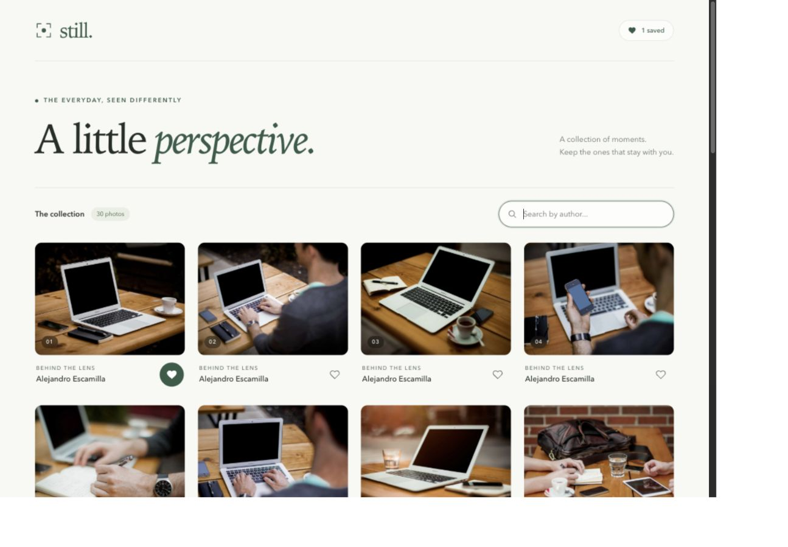

# Still - Photo Gallery

A small photo gallery built for the Celebrare Frontend Intern pre-screening assignment. Browse 30 photographs, search their authors, and save favourites that survive a page refresh.

Built with **React, Vite, and Tailwind CSS**. No component or icon libraries, backend, API key, or environment variables are required.

Repository: [WhiteDevil377/celebrare-photo-gallery](https://github.com/WhiteDevil377/celebrare-photo-gallery)

## Run locally

Use Node.js 22.12 or newer (Node 22 LTS recommended). Clone the repository, then run:

```bash
git clone https://github.com/WhiteDevil377/celebrare-photo-gallery.git
cd celebrare-photo-gallery
npm ci
npm run dev
```

If you already have the project folder, run the npm commands from that folder.

Open the local URL Vite prints, usually `http://127.0.0.1:5173`.

```bash
npm test         # Behaviour and state tests
npm run build    # Production bundle in dist/
npm run preview  # Serve the production build locally
```

The first photo request and the photographs need an internet connection. The dependency versions are recorded in `package-lock.json` for repeatable installation.

## The seven requirements

| Requirement | Implementation |
| --- | --- |
| React + Vite + Tailwind | `vite.config.js`, `src/main.jsx`, `src/index.css`. All page styling uses Tailwind utilities; the CSS entry defines the design tokens. |
| Fetch 30 photos, loading and error states | `src/hooks/useFetchPhotos.js` requests `https://picsum.photos/v2/list?limit=30`. `Gallery.jsx` displays a spinner or an error message. |
| Responsive photo grid | `grid-cols-1 sm:grid-cols-2 lg:grid-cols-4`: one column below 640px, two from 640px, four from 1024px. Each card contains a photo, author, and heart. |
| Search by author in real time | A controlled input updates `search`. Filtering is case-insensitive and ignores leading/trailing spaces. Search never triggers a network request. |
| Favourites with `useReducer` and `localStorage` | `favouritesReducer.js` toggles photo IDs. A lazy initializer restores them before rendering; an effect saves changes under `still:favourites`. |
| `useFetchPhotos` custom hook | Returns exactly `{ photos, loading, error }`. `Gallery` consumes it and never fetches directly. |
| `useCallback` and `useMemo` | `Gallery.jsx` memoizes the search handler and computes the filtered list with `[photos, search]` dependencies. |

## Code map

```text
src/
  main.jsx                       React entry point and Strict Mode
  index.css                      Tailwind import and colour/font tokens
  components/
    Gallery.jsx                  Page, search, reducer wiring, persistence
    PhotoCard.jsx                Photo, author, accessible heart button
    Icons.jsx                    Small inline SVGs
    Gallery.test.jsx             User behaviour and fetch failure tests
  hooks/
    useFetchPhotos.js            Network request and lifecycle cleanup
  reducers/
    favouritesReducer.js         Pure favourite toggle and storage initializer
    favouritesReducer.test.js    Immutability and saved-data recovery tests
  test/setup.js                  Test environment cleanup
docs/
  RECORDING_GUIDE.md             Five-minute walkthrough and practice questions
```

## Decisions you should be able to explain

- **IDs rather than copied photos:** favourite state only needs the stable photo ID. A filtered or reordered list still selects the correct photo.
- **Immutable reducer:** `filter` removes an ID and array spread adds one. Neither changes the previous state. Browser storage is a side effect, so it stays outside the reducer.
- **Lazy initialization:** storage is read before the first rendered state. Starting with an empty array and restoring it in a later effect could overwrite saved favourites.
- **Fetch cleanup:** `AbortController` cancels a request when the component unmounts. Aborted requests do not show an API error or update the old component.
- **Strict Mode:** the development entry point deliberately runs effect setup/cleanup again. You may see an initial cancelled request in DevTools. This is expected; search itself does not fetch.
- **Honest performance explanation:** `useCallback` keeps a function reference stable. `useMemo` caches the filtered array so a heart toggle does not repeat the filter. Removing either and using the equivalent plain function/calculation would not break functionality. With only 30 photos, the speed difference is small; both hooks are present to satisfy and demonstrate the assignment requirement.
- **Image size:** the documented Picsum ID URL requests an 800 x 600 version of each fetched photo, avoiding multi-megabyte originals. Cards use fixed aspect ratios to reduce layout shifts; images below the first four are lazy-loaded.
- **Storage failure:** malformed saved data falls back to an empty list. If browser storage cannot be written, hearts continue to work for the visit and the page explains that they cannot persist.

The app deliberately stays within the requested gallery, author search, and favourites scope.

## Manual checks

1. On a fresh load, confirm the spinner appears before 30 cards.
2. Search for an author visible in the grid. Try mixed case, a partial name, and a name that does not exist. Clear the search.
3. Toggle two hearts, refresh, confirm they remain selected, then remove one and refresh again.
4. In DevTools, inspect Network while typing. There should be no new `/v2/list` request from searching.
5. Check widths of 375px, 768px, and 1440px for one, two, and four columns without horizontal scrolling.
6. In DevTools Network, select Offline and refresh to inspect the error state. Restore the connection and refresh afterwards.
7. Use Tab and Enter/Space to operate the search and hearts. Heart buttons expose their state with `aria-pressed`.

## Submission

The source is published in the public repository linked above. Complete these personal submission steps:

- Record yourself explaining and demonstrating the app for about five minutes. Practise with [the recording guide](docs/RECORDING_GUIDE.md), then use your own wording and describe what you actually understood and worked through.
- Upload the recording to Google Drive with view access, or YouTube as unlisted. Check both links in a private browser window.
- Submit the GitHub link, recording link, and an honest one-line description of the hardest part through the separately shared Google Form, within 24 hours of receiving the brief.

No recording or form submission has been performed. The local `Still-Photo-Gallery-Submission.zip` is a clean source archive without dependencies or build output; it is ignored by Git.

## Verification

The production build and all 15 automated tests pass. The app was also checked in a browser against the live Picsum API, including search, favourites after refresh, and the one/two/four-column layouts. See [the verification record](docs/VERIFICATION.md).



## References

- [Vite setup](https://vite.dev/guide/)
- [Tailwind Vite integration](https://tailwindcss.com/docs/installation/using-vite)
- [Picsum API and sized image URLs](https://picsum.photos/)
- [React useReducer](https://react.dev/reference/react/useReducer), [useCallback](https://react.dev/reference/react/useCallback), and [useMemo](https://react.dev/reference/react/useMemo)
